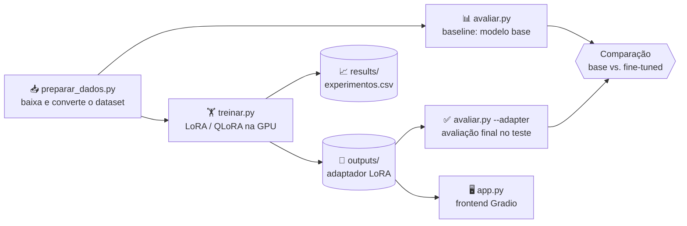
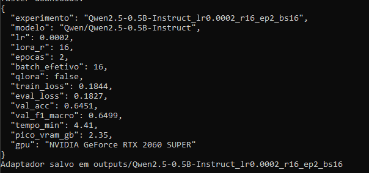
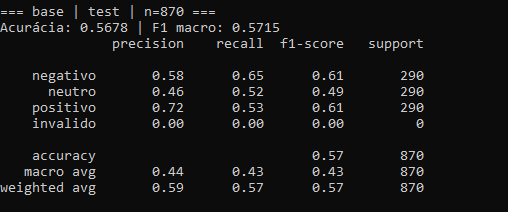
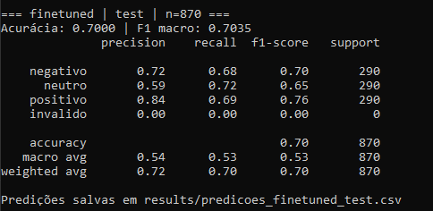
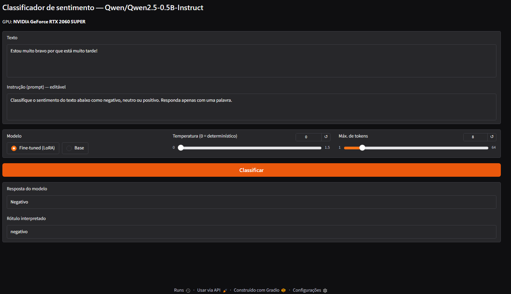
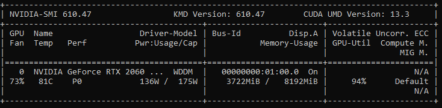
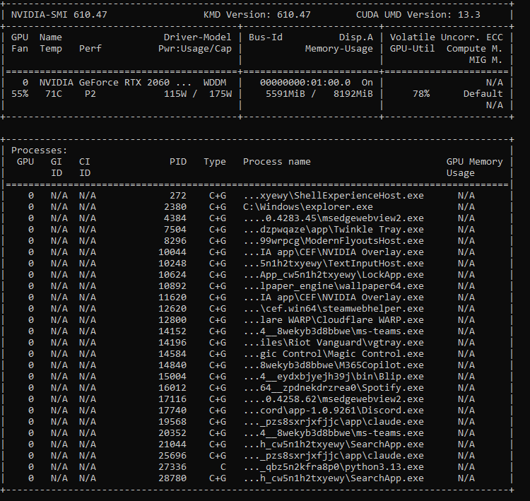

<div align="center">

# 🧠 Classificador de Sentimento em Português com LLM Local

**Fine-tuning de `Qwen2.5-Instruct` com LoRA/QLoRA, 100% na GPU, com frontend interativo**


</div>

---

## 👥 Integrantes

| Nome | RM |
|---|---|
| Debora da Silva Amaral | 550412 |
| Eduardo Pielich | 99767 |
| Livia Namba Seraphim | 97819 |

---

## 📑 Sumário

1. [Visão geral](#-visão-geral)
2. [O problema](#-o-problema)
3. [Modelo escolhido](#-modelo-escolhido)
4. [Dataset](#-dataset)
5. [Pipeline do projeto](#-pipeline-do-projeto)
6. [Estrutura do repositório](#-estrutura-do-repositório)
7. [Instalação e configuração da GPU](#-instalação-e-configuração-da-gpu)
8. [Como executar](#-como-executar)
9. [Como o treinamento funciona](#-como-o-treinamento-funciona)
10. [Experimentos com parâmetros](#-experimentos-com-parâmetros)
11. [Avaliação do modelo](#-avaliação-do-modelo)
12. [Frontend](#-frontend)
13. [Evidência da GPU no VSCode](#-evidência-da-gpu-no-vscode)
14. [Limitações e próximos passos](#-limitações-e-próximos-passos)
15. [Solução de problemas](#-solução-de-problemas)
16. [Referências](#-referências)

---

## 🎯 Visão geral

Este projeto treina uma LLM **localmente**, na GPU, para resolver uma tarefa específica: **classificar o sentimento de textos em português** como `negativo`, `neutro` ou `positivo`.

Em vez de treinar um modelo do zero (inviável em hardware local), usamos **fine-tuning eficiente** de um modelo pequeno já pré-treinado, ajustando apenas uma fração mínima dos pesos com **LoRA**. O projeto cobre todo o ciclo:

| Etapa | O que foi feito |
|---|---|
| 🔎 Escolha do modelo | Qwen2.5-0.5B/1.5B-Instruct |
| 🧩 Problema específico | Classificação de sentimento em português |
| 🧪 Teste de parâmetros | Variação de learning rate, rank LoRA e épocas |
| 📊 Avaliação | Acurácia e F1 macro, base vs. fine-tuned |
| ⚡ GPU | Treino, avaliação e inferência 100% em CUDA |
| 🖥️ Frontend | Interface Gradio com prompt editável |
| 📚 Documentação | Este README + código completo no GitHub |

---

## 🧩 O problema

> **Dado um texto em português, o modelo deve responder com uma única palavra: `negativo`, `neutro` ou `positivo`.**

Por que essa tarefa?

- ✅ **Avaliação objetiva**: cada resposta está certa ou errada, o que permite medir acurácia e F1.
- ✅ **Dataset público e balanceado**, em português.
- ✅ **Mostra bem o efeito do fine-tuning**: um modelo pequeno sem treino costuma responder fora do formato ou errar bastante; depois do treino, tende a seguir o formato e acertar mais.

---

## 🤖 Modelo escolhido

**[Qwen2.5-Instruct](https://huggingface.co/Qwen)** (0.5B e 1.5B de parâmetros).

| Critério | Motivo da escolha |
|---|---|
| Tamanho | Cabe em GPUs de consumo, mesmo com pouca VRAM |
| Português | Modelo multilíngue com bom suporte ao idioma |
| Versão *Instruct* | Já entende o formato de chat/instrução, o que facilita o fine-tuning |
| Licença | Aberta, permite uso acadêmico |
| Ecossistema | Compatível com `transformers`, `peft` e `trl` |

O código usa o 0.5B por padrão. Para o 1.5B, basta passar `--model Qwen/Qwen2.5-1.5B-Instruct`.

---

## 📦 Dataset

**XLM-T, Sentiment (Português)**, da Cardiff NLP: tweets em português rotulados com sentimento.

| Divisão | Exemplos |
|---|---:|
| Treino | 1.839 |
| Validação | 324 |
| Teste | 870 |

- Classes **balanceadas**: negativo, neutro e positivo em proporções praticamente iguais.
- O script `preparar_dados.py` baixa os arquivos direto do repositório oficial no GitHub e converte para `data/*.jsonl` no formato `{"text": "...", "label": "positivo"}`.
- O conjunto de **teste só é usado na avaliação final**; a validação serve para comparar experimentos.

---

## 🔄 Pipeline do projeto



---

## 🗂️ Estrutura do repositório

```
projeto-llm/
├── 📄 README.md             # esta documentação
├── 📄 requirements.txt      # dependências Python
├── 📄 .gitignore
├── 🐍 comum.py              # prompt, rótulos e carregamento do modelo
├── 🐍 preparar_dados.py     # baixa o dataset e gera data/*.jsonl
├── 🐍 treinar.py            # fine-tuning (LoRA/QLoRA) + registro do experimento
├── 🐍 avaliar.py            # métricas e predições (base ou fine-tuned)
├── 🐍 app.py                # frontend Gradio
├── 📁 data/                 # train / validation / test (.jsonl)
├── 📁 results/              # experimentos.csv e predições por modelo
├── 📁 outputs/              # adaptadores LoRA treinados (não versionado)
└── 📁 docs/img/             # prints (GPU no VSCode, frontend)
```

---

## ⚙️ Instalação e configuração da GPU

### Pré-requisitos

- Placa **NVIDIA** com driver instalado (confira com `nvidia-smi`)
- **Python 3.10 ou superior**
- Git

### Passo a passo

```bash
# 1. Clone o repositório
git clone https://github.com/Poliester2005/llmfinetunning.git
cd llmfinetunning

# 2. Crie e ative um ambiente virtual
python -m venv .venv
.venv\Scripts\activate          # Windows
# source .venv/bin/activate     # Linux / macOS

# 3. Instale o PyTorch COM suporte a CUDA (antes das demais dependências!)
pip install torch torchvision --index-url https://download.pytorch.org/whl/cu128

# 4. Instale o restante
pip install -r requirements.txt
```

> ⚠️ **Importante:** no passo 3, escolha o sufixo (`cu126`, `cu128`, `cu130`...) conforme a versão de CUDA exibida no `nvidia-smi`; ela não deve ser maior que a do seu driver. Se instalar o PyTorch sem o índice da NVIDIA, o `pip` pode baixar a versão **somente CPU**, e o projeto não rodará.

### ✅ Verificando se a GPU está funcionando

```bash
nvidia-smi
python -c "import torch; print(torch.cuda.is_available(), torch.cuda.get_device_name(0))"
```

A saída esperada é `True` seguido do nome da placa.

---

## ▶️ Como executar

```bash
# 1️⃣ Baixar e preparar os dados
python preparar_dados.py

# 2️⃣ Baseline: desempenho do modelo ANTES do treino
python avaliar.py

# 3️⃣ Treinar (configuração padrão)
python treinar.py

# 4️⃣ Experimentos com outros parâmetros
python treinar.py --lr 5e-5
python treinar.py --r 8 --epochs 3
python treinar.py --r 32

# 5️⃣ Avaliação final do melhor modelo no conjunto de teste
python avaliar.py --adapter outputs/<nome-do-experimento>

# 6️⃣ Abrir o frontend
python app.py --adapter outputs/<nome-do-experimento>
```

### Opções do `treinar.py`

| Argumento | Padrão | Descrição |
|---|---|---|
| `--model` | `Qwen/Qwen2.5-0.5B-Instruct` | Modelo base do Hugging Face |
| `--lr` | `2e-4` | Taxa de aprendizado |
| `--r` | `16` | Rank do LoRA (`lora_alpha = 2 × r`) |
| `--epochs` | `2` | Número de épocas |
| `--batch-size` | `8` | Batch por passo |
| `--grad-accum` | `2` | Acúmulo de gradiente (batch efetivo = `batch × accum`) |
| `--max-length` | `256` | Tamanho máximo da sequência em tokens |
| `--qlora` | desligado | Carrega o modelo em 4-bit para economizar VRAM |
| `--name` | automático | Nome do experimento |

---

## 🔬 Como o treinamento funciona

### 1. Formato do prompt

Cada exemplo vira uma conversa no formato de chat do modelo:

```
[system]    Você é um assistente que classifica o sentimento de textos em português.
[user]      Classifique o sentimento do texto abaixo como negativo, neutro ou positivo.
            Responda apenas com uma palavra.

            Texto: <texto do tweet>
[assistant] positivo
```

### 2. LoRA (Low-Rank Adaptation)

Em vez de atualizar todos os bilhões de pesos, o LoRA **congela o modelo original** e treina pequenas matrizes de baixo rank acrescentadas às camadas lineares. Resultado: treino muito mais rápido, uso de memória baixo e um **adaptador de poucos MB** em vez de um modelo inteiro.

| Hiperparâmetro | Valor |
|---|---|
| Rank (`r`) | 16 (variável nos experimentos) |
| `lora_alpha` | `2 × r` |
| Dropout | 0,05 |
| Módulos-alvo | todas as camadas lineares (`all-linear`) |

### 3. QLoRA (opcional)

Com `--qlora`, o modelo base é carregado em **4 bits (NF4)** e só o adaptador é treinado em maior precisão, o que reduz bastante o consumo de VRAM e permite modelos maiores em placas menores.

### 4. Loss somente na resposta

O dataset usa o formato `prompt` / `completion`: a perda é calculada **apenas sobre a resposta** (`negativo`, `neutro` ou `positivo`), e não sobre o texto do tweet, o que torna o aprendizado mais focado.

### 5. Configuração de treino

| Item | Valor |
|---|---|
| Otimizador / scheduler | AdamW com scheduler *cosine* e *warmup* de 5% |
| Precisão | `bf16` quando a GPU suporta, senão `fp16` |
| Semente | `42` (reprodutibilidade) |
| Biblioteca | `trl.SFTTrainer` + `peft` |

Ao final de cada treino, o script salva o adaptador em `outputs/<experimento>/`, mede acurácia e F1 na validação e registra tudo em `results/experimentos.csv`, incluindo **tempo de treino e pico de VRAM**.

---

## 🧪 Experimentos com parâmetros

Plano de experimentos (variando um fator por vez a partir da configuração padrão):

| # | Experimento | Comando |
|---|---|---|
| 0 | Baseline (sem treino) | `python avaliar.py` |
| 1 | Configuração padrão | `python treinar.py` |
| 2 | Learning rate menor | `python treinar.py --lr 5e-5` |
| 3 | Rank menor + mais épocas | `python treinar.py --r 8 --epochs 3` |
| 4 | Rank maior | `python treinar.py --r 32` |
| 5 | Modelo maior (opcional) | `python treinar.py --model Qwen/Qwen2.5-1.5B-Instruct` |

### 📋 Resultados dos experimentos (validação)

Dados registrados automaticamente pelo `treinar.py` em `results/experimentos.csv`:



Resumo em tabela:

| Experimento | LR | Rank | Épocas | Batch ef. | Train loss | Eval loss | Acurácia | F1 macro | Tempo (min) | VRAM (GB) |
|---|---|---|---|---|---|---|---|---|---|---|
| Padrão | 2e-4 | 16 | 2 | 16 | 0,1844 | 0,1827 | 0,6451 | 0,6499 | 4,41 | 2,35 |
| LR menor | 5e-5 | 16 | 2 | 16 | 0,1882 | 0,1965 | 0,6142 | 0,6169 | 8,11 | 2,35 |
| Rank 8, 3 épocas | 2e-4 | 8 | 3 | 16 | 0,1525 | 0,2241 | 0,6420 | 0,6439 | 4,75 | 2,28 |
| **Rank 32** | 2e-4 | 32 | 2 | 16 | 0,1818 | 0,1830 | **0,6574** | **0,6613** | 3,12 | 2,49 |

### 💡 Análise dos parâmetros

> O baseline (modelo sem treino) foi medido apenas no conjunto de **teste**; ver a seção de avaliação.

**Configuração padrão** (LR 2e-4, rank 16, 2 épocas, batch efetivo 16):

- Alcançou **64,51% de acurácia** e **F1 macro de 64,99%** na validação.
- *Train loss* (0,1844) e *eval loss* (0,1827) ficaram muito próximas, o que não indica *overfitting* após 2 épocas. A *train loss* é a média do treino inteiro, então a comparação é aproximada.
- O treino levou **4,41 minutos** e usou no máximo **2,35 GB de VRAM** na RTX 2060 SUPER (8 GB), o que deixa bastante margem para testar rank maior ou o modelo de 1,5B.

**Comparação entre os experimentos (validação, 324 exemplos):**

- **Melhor configuração: rank 32** (LR 2e-4, 2 épocas), com 65,74% de acurácia e F1 de 66,13%, seguida da configuração padrão (rank 16), com 64,51%.
- **LR menor (5e-5) foi a pior**: 61,42% de acurácia e a maior *eval loss* entre as configurações de 2 épocas (0,1965). Com poucas épocas, uma taxa de aprendizado baixa não deu ao modelo tempo suficiente para aprender (*underfitting*).
- **Rank 8 com 3 épocas mostra sinal de *overfitting***: a *train loss* caiu para 0,1525, mas a *eval loss* subiu para 0,2241 (a maior de todas), e a acurácia (64,20%) não superou a da configuração padrão. Mais épocas não compensaram.
- **Rank 16 → 32** trouxe um ganho pequeno (+1,2 ponto de acurácia) com *eval loss* praticamente igual (0,1827 vs 0,1830), e custou apenas ~0,14 GB de VRAM a mais (2,35 → 2,49 GB). Essa diferença está dentro da margem de erro (cerca de ±5 pontos com 324 exemplos e uma única semente), portanto o rank teve efeito pequeno e não conclusivo.
- **Tempo de treino:** o experimento de LR menor levou 8,11 min contra 3 a 5 min nos demais, apesar de ter o mesmo custo computacional da configuração padrão. A diferença provavelmente vem da carga da máquina durante a execução (outros programas usando a GPU), e não do parâmetro.
- **Memória:** o pico de VRAM ficou entre 2,28 e 2,49 GB em todos os casos, bem abaixo dos 8 GB da placa.

---

## 📊 Avaliação do modelo

### Como a avaliação é feita

- Geração **determinística** (`do_sample=False`) com até 6 tokens.
- A resposta é convertida em rótulo procurando `negativo`, `neutro` ou `positivo` no texto gerado.
- Respostas fora do formato contam como **`invalido`** e são consideradas **erro**, o que penaliza modelos que não seguem a instrução.
- Métricas: **acurácia** e **F1 macro** (média do F1 das três classes, sem favorecer nenhuma).
- As predições completas ficam em `results/predicoes_<base|finetuned>_<split>.csv` para análise de erros.

### 🏁 Resultado final no conjunto de teste

**Modelo base** (`python avaliar.py`):



**Modelo fine-tuned** (`python avaliar.py --adapter outputs/<melhor>`):



Resumo:

| Modelo | Acurácia | F1 macro | Respostas inválidas |
|---|---:|---:|---:|
| Base (sem fine-tuning) | 0,5678 | 0,5715 | 3 |
| Fine-tuned (LoRA, configuração padrão) | 0,7000 | 0,7035 | 0 |

**F1 por classe (teste, 870 exemplos, 290 por classe):**

| Classe | F1 base | F1 fine-tuned | Variação |
|---|---:|---:|---:|
| negativo | 0,61 | 0,70 | +0,09 |
| neutro | 0,49 | 0,65 | +0,16 |
| positivo | 0,61 | 0,76 | +0,15 |

**Matriz de confusão (linhas = rótulo real, colunas = previsão):**

Modelo base:

| Real \ Previsto | negativo | neutro | positivo | inválido |
|---|---:|---:|---:|---:|
| negativo | 189 | 78 | 21 | 2 |
| neutro | 100 | 152 | 38 | 0 |
| positivo | 36 | 100 | 153 | 1 |

Fine-tuned (configuração padrão):

| Real \ Previsto | negativo | neutro | positivo |
|---|---:|---:|---:|
| negativo | 198 | 75 | 17 |
| neutro | 58 | 210 | 22 |
| positivo | 19 | 70 | 201 |

O modelo base deu **3 respostas fora do formato** (`Negação`); o fine-tuned, **nenhuma**.

### 🔍 Exemplos de respostas

Exemplos do conjunto de teste (fonte: `results/predicoes_*_test.csv`):

| Texto | Esperado | Base | Fine-tuned |
|---|---|---|---|
| Camila Queirós sempre lindaaaa #VideoShowAoVivo | positivo | neutro ❌ | positivo ✅ |
| #MasterChefBR Já estou aqui ansiosa pra assistir. 😬😬😬😬😬 | positivo | neutro ❌ | positivo ✅ |
| Genteee a Ana Furtado é zero carisma #EDeCasa | negativo | neutro ❌ | negativo ✅ |
| Pega a da lata e faz macarrão com sardinha rapidinho #MasterChefBR | neutro | positivo ❌ | neutro ✅ |
| Eu to tremendo #MasterChefBR | negativo | negativo ✅ | positivo ❌ |
| Falta pouco #MasterChefBR 👀💖😋 | positivo | positivo ✅ | negativo ❌ |
| @user @user Suenia vem aqui me abraçar #VideoShowAoVivo | neutro | neutro ✅ | positivo ❌ |
| A Sophia só é bonita, pois não tem talento algum #VideoShowAoVivo | negativo | neutro ❌ | neutro ❌ |
| Clipe inédito de CDA no #DomingoLegal Será que é Aquarela?🤔😍 | positivo | neutro ❌ | neutro ❌ |
| Cadê o Theo? #MaisVocê | neutro | negativo ❌ | negativo ❌ |

### 🧾 Análise

- O fine-tuning elevou a **acurácia de 56,78% para 70,00%** e o **F1 macro de 57,15% para 70,35%** (cerca de **+13 pontos percentuais** em ambas), com apenas 4,4 minutos de treino.
- Todas as classes melhoraram. Os maiores ganhos foram em `neutro` (+0,16) e `positivo` (+0,15).
- **`neutro` continua sendo a classe mais difícil** (F1 0,65). Seu recall é alto (0,72), mas a precisão é menor (0,59): o modelo previu `neutro` 355 vezes, embora existam só 290 exemplos dessa classe, algo comum quando o limite entre neutro e as outras classes é subjetivo.
- Em `positivo`, a precisão é alta (0,84) e o recall é menor (0,69): quando o modelo diz que é positivo, costuma acertar, mas deixa passar parte dos textos positivos: **70 dos 89 positivos errados foram classificados como neutros** (a matriz de confusão acima). O mesmo vale para `negativo`, em que 75 dos 92 erros foram para `neutro`.
- **Padrão dos erros** (observando os exemplos): os erros se concentram em textos curtos, sem uma palavra clara de sentimento, com emojis e hashtags, ou com polaridade mista (elogio e crítica no mesmo texto). Nesses casos o modelo tende a escolher o rótulo intermediário (`neutro`). É uma observação qualitativa, e não uma medição.
- A acurácia na validação (64,5%) ficou abaixo da do teste (70,0%). São conjuntos diferentes e pequenos: com 324 exemplos a margem de erro é de cerca de ±5 pontos, então a diferença não indica problema. O ganho de ~13 pontos sobre o baseline é maior que essas margens.
- **Ressalva:** os resultados vêm de uma única execução (uma semente); para conclusões mais firmes seria preciso repetir com sementes diferentes.

---

## 🖥️ Frontend

Interface construída com **Gradio**, rodando localmente sobre o modelo treinado:

```bash
python app.py --adapter outputs/<nome-do-experimento>
```

Depois abra o endereço exibido no terminal (normalmente `http://127.0.0.1:7860`).

| Recurso | Descrição |
|---|---|
| ✍️ Texto | Caixa para o usuário digitar o texto a classificar |
| 🧾 Instrução editável | O usuário pode **criar/alterar o prompt**; é útil para ver como o modelo reage a instruções diferentes das do treino |
| 🔀 Modelo | Alterna entre **Base** e **Fine-tuned**, no mesmo carregamento |
| 🌡️ Temperatura | `0` = determinístico; valores maiores geram respostas mais variadas |
| 🔢 Máx. de tokens | Limite do tamanho da resposta |
| 🏷️ Saída | Resposta bruta do modelo + rótulo interpretado |

O nome da GPU em uso aparece no topo da página.



---

## 📸 Evidência da GPU no VSCode

Print do terminal do VSCode mostrando a GPU instalada e em uso:

```bash
nvidia-smi
python -c "import torch; print(torch.cuda.is_available(), torch.cuda.get_device_name(0))"
```



`nvidia-smi` **durante o treino**: GPU a 78% de utilização e 5.591 MiB dos 8.192 MiB em uso; o processo `python3.13.exe` aparece como processo de computação (tipo `C`). O total de memória que o `nvidia-smi` mostra inclui os demais programas abertos no Windows, por isso é maior que o pico de 2,35 GB reportado pelo PyTorch.



---

## 🚧 Limitações e próximos passos

**Limitações**

- Dataset pequeno (cerca de 1,8 mil exemplos de treino) e restrito a tweets, então o modelo pode generalizar mal para outros domínios.
- A classe `neutro` é naturalmente ambígua, o que limita o teto de acurácia.
- Modelos de 0.5B/1.5B têm capacidade limitada para ironia e contexto implícito.
- Os experimentos usam uma única semente; para conclusões estatísticas seriam necessárias várias execuções.

**Próximos passos**

- Testar o Qwen2.5-3B ou maiores com QLoRA.
- Ampliar o treino com mais dados em português e outros domínios.
- Adicionar classificação de **intenção** como segunda tarefa.
- Fazer o *merge* do adaptador no modelo base e exportar para formatos de inferência otimizados.

---

## 🛠️ Solução de problemas

| Sintoma | Causa provável | Solução |
|---|---|---|
| `CUDA não disponível` | PyTorch instalado sem CUDA (versão CPU) | Reinstale com o índice `--index-url https://download.pytorch.org/whl/cu128` (ou o compatível com seu driver) |
| `nvidia-smi` não encontrado | Driver NVIDIA ausente | Instale/atualize o driver da placa |
| `CUDA out of memory` | VRAM insuficiente | Reduza `--batch-size` (aumentando `--grad-accum`), reduza `--max-length` ou use `--qlora` |
| Erro no `SFTConfig`/`SFTTrainer` | Versão do `trl` diferente da esperada | Atualize com `pip install -U trl transformers peft` |
| Erro ao instalar `bitsandbytes` | Versão do Python/CUDA sem build disponível | Use um ambiente com Python 3.12 e atualize o pacote |

---

## 📚 Referências

- [Qwen2.5](https://huggingface.co/Qwen), modelos usados
- [LoRA: Low-Rank Adaptation of Large Language Models](https://arxiv.org/abs/2106.09685)
- [QLoRA: Efficient Finetuning of Quantized LLMs](https://arxiv.org/abs/2305.14314)
- [XLM-T: Multilingual Language Models in Twitter for Sentiment Analysis and Beyond](https://github.com/cardiffnlp/xlm-t), dataset
- [Hugging Face Transformers](https://github.com/huggingface/transformers), [PEFT](https://github.com/huggingface/peft), [TRL](https://github.com/huggingface/trl)
- [Gradio](https://www.gradio.app/)

---

<div align="center">

Desenvolvido por **Debora da Silva Amaral**, **Eduardo Pielich** e **Livia Namba Seraphim** · [Repositório](https://github.com/Poliester2005/llmfinetunning)

</div>
