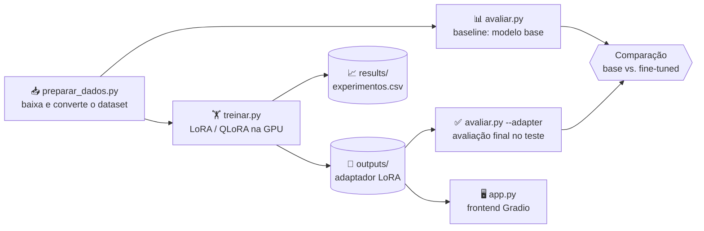

<div align="center">

# 🧠 Classificador de Sentimento em Português com LLM Local

**Fine-tuning de `Qwen2.5-Instruct` com LoRA/QLoRA, 100% na GPU, com frontend interativo**


</div>

---

## 📑 Sumário

1. [Visão geral](#-visão-geral)
2. [O problema](#-o-problema)
3. [Modelo escolhido](#-modelo-escolhido)
4. [Dataset](#-dataset)
5. [Pipeline do projeto](#-pipeline-do-projeto)
6. [Estrutura do repositório](#-estrutura-do-repositório)
7. [Instalação e configuração da GPU](#-instalação-e-configuração-da-gpu)
8. [Como executar](#-como-executar)
9. [Como o treinamento funciona](#-como-o-treinamento-funciona)
10. [Experimentos com parâmetros](#-experimentos-com-parâmetros)
11. [Avaliação do modelo](#-avaliação-do-modelo)
12. [Frontend](#-frontend)
13. [Evidência da GPU no VSCode](#-evidência-da-gpu-no-vscode)
14. [Limitações e próximos passos](#-limitações-e-próximos-passos)
15. [Solução de problemas](#-solução-de-problemas)
16. [Referências](#-referências)

---

## 🎯 Visão geral

Este projeto treina uma LLM **localmente**, na GPU, para resolver uma tarefa específica: **classificar o sentimento de textos em português** como `negativo`, `neutro` ou `positivo`.

Em vez de treinar um modelo do zero (inviável em hardware local), usamos **fine-tuning eficiente** de um modelo pequeno já pré-treinado, ajustando apenas uma fração mínima dos pesos com **LoRA**. O projeto cobre todo o ciclo:

| Etapa | O que foi feito |
|---|---|
| 🔎 Escolha do modelo | Qwen2.5-0.5B/1.5B-Instruct |
| 🧩 Problema específico | Classificação de sentimento em português |
| 🧪 Teste de parâmetros | Variação de learning rate, rank LoRA e épocas |
| 📊 Avaliação | Acurácia e F1 macro, base vs. fine-tuned |
| ⚡ GPU | Treino, avaliação e inferência 100% em CUDA |
| 🖥️ Frontend | Interface Gradio com prompt editável |
| 📚 Documentação | Este README + código completo no GitHub |

---

## 🧩 O problema

> **Dado um texto em português, o modelo deve responder com uma única palavra: `negativo`, `neutro` ou `positivo`.**

Por que essa tarefa?

- ✅ **Avaliação objetiva**: cada resposta está certa ou errada, o que permite medir acurácia e F1.
- ✅ **Dataset público e balanceado**, em português.
- ✅ **Mostra bem o efeito do fine-tuning**: um modelo pequeno sem treino costuma responder fora do formato ou errar bastante; depois do treino, tende a seguir o formato e acertar mais.

---

## 🤖 Modelo escolhido

**[Qwen2.5-Instruct](https://huggingface.co/Qwen)** (0.5B e 1.5B de parâmetros).

| Critério | Motivo da escolha |
|---|---|
| Tamanho | Cabe em GPUs de consumo, mesmo com pouca VRAM |
| Português | Modelo multilíngue com bom suporte ao idioma |
| Versão *Instruct* | Já entende o formato de chat/instrução, o que facilita o fine-tuning |
| Licença | Aberta, permite uso acadêmico |
| Ecossistema | Compatível com `transformers`, `peft` e `trl` |

O código usa o 0.5B por padrão. Para o 1.5B, basta passar `--model Qwen/Qwen2.5-1.5B-Instruct`.

---

## 📦 Dataset

**XLM-T, Sentiment (Português)**, da Cardiff NLP: tweets em português rotulados com sentimento.

| Divisão | Exemplos |
|---|---:|
| Treino | 1.839 |
| Validação | 324 |
| Teste | 870 |

- Classes **balanceadas**: negativo, neutro e positivo em proporções praticamente iguais.
- O script `preparar_dados.py` baixa os arquivos direto do repositório oficial no GitHub e converte para `data/*.jsonl` no formato `{"text": "...", "label": "positivo"}`.
- O conjunto de **teste só é usado na avaliação final**; a validação serve para comparar experimentos.

---

## 🔄 Pipeline do projeto



---

## 🗂️ Estrutura do repositório

```
projeto-llm/
├── 📄 README.md             # esta documentação
├── 📄 requirements.txt      # dependências Python
├── 📄 .gitignore
├── 🐍 comum.py              # prompt, rótulos e carregamento do modelo
├── 🐍 preparar_dados.py     # baixa o dataset e gera data/*.jsonl
├── 🐍 treinar.py            # fine-tuning (LoRA/QLoRA) + registro do experimento
├── 🐍 avaliar.py            # métricas e predições (base ou fine-tuned)
├── 🐍 app.py                # frontend Gradio
├── 📁 data/                 # train / validation / test (.jsonl)
├── 📁 results/              # experimentos.csv e predições por modelo
├── 📁 outputs/              # adaptadores LoRA treinados (não versionado)
└── 📁 docs/img/             # prints (GPU no VSCode, frontend)
```

---

## ⚙️ Instalação e configuração da GPU

### Pré-requisitos

- Placa **NVIDIA** com driver instalado (confira com `nvidia-smi`)
- **Python 3.10 ou superior**
- Git

### Passo a passo

```bash
# 1. Clone o repositório
git clone https://github.com/Poliester2005/<nome-do-repositorio>.git
cd <nome-do-repositorio>

# 2. Crie e ative um ambiente virtual
python -m venv .venv
.venv\Scripts\activate          # Windows
# source .venv/bin/activate     # Linux / macOS

# 3. Instale o PyTorch COM suporte a CUDA (antes das demais dependências!)
pip install torch torchvision --index-url https://download.pytorch.org/whl/cu128

# 4. Instale o restante
pip install -r requirements.txt
```

> ⚠️ **Importante:** no passo 3, escolha o sufixo (`cu126`, `cu128`, `cu130`...) conforme a versão de CUDA exibida no `nvidia-smi`; ela não deve ser maior que a do seu driver. Se instalar o PyTorch sem o índice da NVIDIA, o `pip` pode baixar a versão **somente CPU**, e o projeto não rodará.

### ✅ Verificando se a GPU está funcionando

```bash
nvidia-smi
python -c "import torch; print(torch.cuda.is_available(), torch.cuda.get_device_name(0))"
```

A saída esperada é `True` seguido do nome da placa.

---

## ▶️ Como executar

```bash
# 1️⃣ Baixar e preparar os dados
python preparar_dados.py

# 2️⃣ Baseline: desempenho do modelo ANTES do treino
python avaliar.py

# 3️⃣ Treinar (configuração padrão)
python treinar.py

# 4️⃣ Experimentos com outros parâmetros
python treinar.py --lr 5e-5
python treinar.py --r 8 --epochs 3
python treinar.py --r 32

# 5️⃣ Avaliação final do melhor modelo no conjunto de teste
python avaliar.py --adapter outputs/<nome-do-experimento>

# 6️⃣ Abrir o frontend
python app.py --adapter outputs/<nome-do-experimento>
```

### Opções do `treinar.py`

| Argumento | Padrão | Descrição |
|---|---|---|
| `--model` | `Qwen/Qwen2.5-0.5B-Instruct` | Modelo base do Hugging Face |
| `--lr` | `2e-4` | Taxa de aprendizado |
| `--r` | `16` | Rank do LoRA (`lora_alpha = 2 × r`) |
| `--epochs` | `2` | Número de épocas |
| `--batch-size` | `8` | Batch por passo |
| `--grad-accum` | `2` | Acúmulo de gradiente (batch efetivo = `batch × accum`) |
| `--max-length` | `256` | Tamanho máximo da sequência em tokens |
| `--qlora` | desligado | Carrega o modelo em 4-bit para economizar VRAM |
| `--name` | automático | Nome do experimento |

---

## 🔬 Como o treinamento funciona

### 1. Formato do prompt

Cada exemplo vira uma conversa no formato de chat do modelo:

```
[system]    Você é um assistente que classifica o sentimento de textos em português.
[user]      Classifique o sentimento do texto abaixo como negativo, neutro ou positivo.
            Responda apenas com uma palavra.

            Texto: <texto do tweet>
[assistant] positivo
```

### 2. LoRA (Low-Rank Adaptation)

Em vez de atualizar todos os bilhões de pesos, o LoRA **congela o modelo original** e treina pequenas matrizes de baixo rank acrescentadas às camadas lineares. Resultado: treino muito mais rápido, uso de memória baixo e um **adaptador de poucos MB** em vez de um modelo inteiro.

| Hiperparâmetro | Valor |
|---|---|
| Rank (`r`) | 16 (variável nos experimentos) |
| `lora_alpha` | `2 × r` |
| Dropout | 0,05 |
| Módulos-alvo | todas as camadas lineares (`all-linear`) |

### 3. QLoRA (opcional)

Com `--qlora`, o modelo base é carregado em **4 bits (NF4)** e só o adaptador é treinado em maior precisão, o que reduz bastante o consumo de VRAM e permite modelos maiores em placas menores.

### 4. Loss somente na resposta

O dataset usa o formato `prompt` / `completion`: a perda é calculada **apenas sobre a resposta** (`negativo`, `neutro` ou `positivo`), e não sobre o texto do tweet, o que torna o aprendizado mais focado.

### 5. Configuração de treino

| Item | Valor |
|---|---|
| Otimizador / scheduler | AdamW com scheduler *cosine* e *warmup* de 5% |
| Precisão | `bf16` quando a GPU suporta, senão `fp16` |
| Semente | `42` (reprodutibilidade) |
| Biblioteca | `trl.SFTTrainer` + `peft` |

Ao final de cada treino, o script salva o adaptador em `outputs/<experimento>/`, mede acurácia e F1 na validação e registra tudo em `results/experimentos.csv`, incluindo **tempo de treino e pico de VRAM**.

---

## 🧪 Experimentos com parâmetros

Plano de experimentos (variando um fator por vez a partir da configuração padrão):

| # | Experimento | Comando |
|---|---|---|
| 0 | Baseline (sem treino) | `python avaliar.py` |
| 1 | Configuração padrão | `python treinar.py` |
| 2 | Learning rate menor | `python treinar.py --lr 5e-5` |
| 3 | Rank menor + mais épocas | `python treinar.py --r 8 --epochs 3` |
| 4 | Rank maior | `python treinar.py --r 32` |
| 5 | Modelo maior (opcional) | `python treinar.py --model Qwen/Qwen2.5-1.5B-Instruct` |

### 📋 Resultados dos experimentos (validação)

> Preencher com os valores de `results/experimentos.csv` depois de rodar.

| Experimento | LR | Rank | Épocas | Batch ef. | Train loss | Eval loss | Acurácia | F1 macro | Tempo (min) | VRAM (GB) |
|---|---|---|---|---|---|---|---|---|---|---|
| Baseline (sem treino) | - | - | - | - | - | - | _ | _ | - | _ |
| Padrão | 2e-4 | 16 | 2 | 16 | _ | _ | _ | _ | _ | _ |
| LR menor | 5e-5 | 16 | 2 | 16 | _ | _ | _ | _ | _ | _ |
| Rank 8, 3 épocas | 2e-4 | 8 | 3 | 16 | _ | _ | _ | _ | _ | _ |
| Rank 32 | 2e-4 | 32 | 2 | 16 | _ | _ | _ | _ | _ | _ |

### 💡 Análise dos parâmetros

> Escrever aqui as conclusões: qual configuração foi melhor, se mais épocas causaram *overfitting* (eval loss subindo enquanto train loss cai), se aumentar o rank compensou o custo de memória e tempo, etc.

---

## 📊 Avaliação do modelo

### Como a avaliação é feita

- Geração **determinística** (`do_sample=False`) com até 6 tokens.
- A resposta é convertida em rótulo procurando `negativo`, `neutro` ou `positivo` no texto gerado.
- Respostas fora do formato contam como **`invalido`** e são consideradas **erro**, o que penaliza modelos que não seguem a instrução.
- Métricas: **acurácia** e **F1 macro** (média do F1 das três classes, sem favorecer nenhuma).
- As predições completas ficam em `results/predicoes_<base|finetuned>_<split>.csv` para análise de erros.

### 🏁 Resultado final no conjunto de teste

> Preencher após rodar `python avaliar.py` e `python avaliar.py --adapter outputs/<melhor>`.

| Modelo | Acurácia | F1 macro | Respostas inválidas |
|---|---:|---:|---:|
| Base (sem fine-tuning) | _ | _ | _ |
| Fine-tuned (LoRA) | _ | _ | _ |

### 🔍 Exemplos de respostas

> Inserir 5 a 10 exemplos lado a lado (texto, esperado, base, fine-tuned), incluindo erros.

| Texto | Esperado | Base | Fine-tuned |
|---|---|---|---|
| _ | _ | _ | _ |

### 🧾 Análise

> O que melhorou? Em qual classe o modelo mais erra (normalmente `neutro`)? Há padrões nos erros, como ironia, gírias ou hashtags?

---

## 🖥️ Frontend

Interface construída com **Gradio**, rodando localmente sobre o modelo treinado:

```bash
python app.py --adapter outputs/<nome-do-experimento>
```

Depois abra o endereço exibido no terminal (normalmente `http://127.0.0.1:7860`).

| Recurso | Descrição |
|---|---|
| ✍️ Texto | Caixa para o usuário digitar o texto a classificar |
| 🧾 Instrução editável | O usuário pode **criar/alterar o prompt**; é útil para ver como o modelo reage a instruções diferentes das do treino |
| 🔀 Modelo | Alterna entre **Base** e **Fine-tuned**, no mesmo carregamento |
| 🌡️ Temperatura | `0` = determinístico; valores maiores geram respostas mais variadas |
| 🔢 Máx. de tokens | Limite do tamanho da resposta |
| 🏷️ Saída | Resposta bruta do modelo + rótulo interpretado |

O nome da GPU em uso aparece no topo da página.

> 📸 _Inserir aqui um print do frontend em `docs/img/frontend.png`_

---

## 📸 Evidência da GPU no VSCode

Print do terminal do VSCode mostrando a GPU instalada e em uso:

```bash
nvidia-smi
python -c "import torch; print(torch.cuda.is_available(), torch.cuda.get_device_name(0))"
```

> Inserir aqui: ``

Também vale registrar um `nvidia-smi` **durante o treino**, mostrando uso de GPU e memória:

> Inserir aqui: ``

---

## 🚧 Limitações e próximos passos

**Limitações**

- Dataset pequeno (cerca de 1,8 mil exemplos de treino) e restrito a tweets, então o modelo pode generalizar mal para outros domínios.
- A classe `neutro` é naturalmente ambígua, o que limita o teto de acurácia.
- Modelos de 0.5B/1.5B têm capacidade limitada para ironia e contexto implícito.
- Os experimentos usam uma única semente; para conclusões estatísticas seriam necessárias várias execuções.

**Próximos passos**

- Testar o Qwen2.5-3B ou maiores com QLoRA.
- Ampliar o treino com mais dados em português e outros domínios.
- Adicionar classificação de **intenção** como segunda tarefa.
- Fazer o *merge* do adaptador no modelo base e exportar para formatos de inferência otimizados.

---

## 🛠️ Solução de problemas

| Sintoma | Causa provável | Solução |
|---|---|---|
| `CUDA não disponível` | PyTorch instalado sem CUDA (versão CPU) | Reinstale com o índice `--index-url https://download.pytorch.org/whl/cu128` (ou o compatível com seu driver) |
| `nvidia-smi` não encontrado | Driver NVIDIA ausente | Instale/atualize o driver da placa |
| `CUDA out of memory` | VRAM insuficiente | Reduza `--batch-size` (aumentando `--grad-accum`), reduza `--max-length` ou use `--qlora` |
| Erro no `SFTConfig`/`SFTTrainer` | Versão do `trl` diferente da esperada | Atualize com `pip install -U trl transformers peft` |
| Erro ao instalar `bitsandbytes` | Versão do Python/CUDA sem build disponível | Use um ambiente com Python 3.12 e atualize o pacote |

---

## 📚 Referências

- [Qwen2.5](https://huggingface.co/Qwen), modelos usados
- [LoRA: Low-Rank Adaptation of Large Language Models](https://arxiv.org/abs/2106.09685)
- [QLoRA: Efficient Finetuning of Quantized LLMs](https://arxiv.org/abs/2305.14314)
- [XLM-T: Multilingual Language Models in Twitter for Sentiment Analysis and Beyond](https://github.com/cardiffnlp/xlm-t), dataset
- [Hugging Face Transformers](https://github.com/huggingface/transformers), [PEFT](https://github.com/huggingface/peft), [TRL](https://github.com/huggingface/trl)
- [Gradio](https://www.gradio.app/)

---

<div align="center">

Desenvolvido por **Eduardo Pielich Sanchez** · [GitHub](https://github.com/Poliester2005)

</div>
